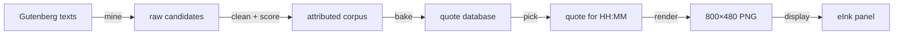
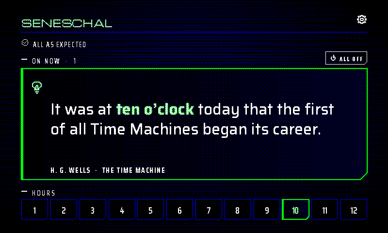
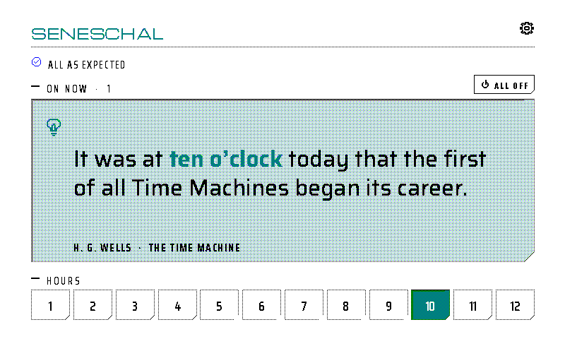
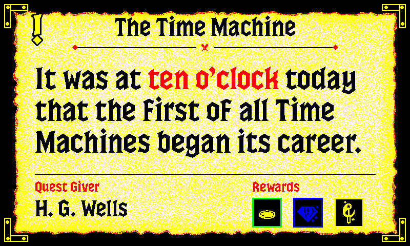

<p align="center">
  
</p>

[](https://github.com/gkoch02/IdleHours/actions/workflows/ci.yml)
[](https://github.com/gkoch02/IdleHours/actions/workflows/github-code-scanning/codeql)
[](pyproject.toml)
[](https://www.raspberrypi.com)
[](LICENSE)

Idle Hours is a literary clock: every few minutes it shows a sentence from a public-domain novel that names the current time, with the time phrase picked out in bold. Behind it is a pipeline that mines Project Gutenberg for phrases like "a quarter past seven", cleans and scores them, and bakes them into a database ranked for each five-minute slot of the twelve-hour clock. A Raspberry Pi renders the pick for a six-colour eInk panel and runs unattended as a systemd appliance, with a small web UI for curating the corpus.


The panel on my desk, in the `sampler` theme. Below are four more themes as straight renders:


The mining pipeline and the appliance runtime are the product. The themes ([full table](#themes), design notes in [`docs/themes.md`](docs/themes.md)) are an open-ended creative layer built on a shared, golden-tested rendering toolkit.

## How it works



1. **Mine.** Regexes find time phrases ("ten minutes to midnight", "the clock struck three") in Gutenberg books; overlapping matches resolve longest-first so "nearly one o'clock" is not also filed at 01:00.
2. **Clean and score.** Each hit becomes a displayable excerpt, gets a 0–100 quality score with named penalty flags, and picks up title and author. Hand fixes live in a sidecar, [`content_overrides.json`](idle_hours/assets/content_overrides.json), applied on top.
3. **Bake.** Ten of the twelve score components do not depend on the requested time. The baker computes them once and stores them on each row, so the runtime only adds the other two.
4. **Pick.** The runtime maps the time to one of 144 fuzzy buckets, ranks candidates, skips anything shown in the last two months and the author shown a moment ago, and falls back to the nearest neighbouring bucket when one is empty.
5. **Render and display.** Pillow lays out the quote, snaps it to the panel's six inks, and pushes it to the Inky Impression. The loop repaints only when the bucket changes.

The build side (steps 1–3) exists to improve coverage and quality over time and is separate from the render loop: re-running the bake is what makes new corpus rows visible to a running appliance, and a raw-corpus change committed without a bake ships no runtime effect. Every stage, its command, the data model and the per-file contract are in [`docs/pipeline.md`](docs/pipeline.md); the runtime loop and every flag in [`docs/runtime.md`](docs/runtime.md).

## Engineering highlights

- **Bake/raw pick equivalence.** The baked database must pick the same row as scoring the raw corpus live, for every one of the 144 buckets ([`TestPickEquivalenceShippedCorpus`](tests/test_bake_equivalence.py)).
- **Pin fidelity against the shipped corpus.** The runtime peeks a quote, then tells the render subprocess to draw exactly that row. Because `(source_id, line_number)` does not identify a row (one line can carry several time phrases), a pin carries `matched_text` too, and a sweep over every clock time against the real database ([`TestPinFidelityAgainstShippedCorpus`](tests/test_pick_quote.py)) holds it to that.
- **Durability.** State, overrides, the corpus and the rendered PNG are replaced through [`atomic_io`](idle_hours/atomic_io.py) (unique temp file, fsync, rename, fsync the directory), so a power cut mid-write leaves the previous file intact and two writers of one target never blend. The append-only history ledger fsyncs each line and the reader skips a torn last line. A [`pidfile`](idle_hours/pidfile.py) keeps one instance running. Configuration errors exit 42, which the [systemd unit](ops/idle-hours.service.example) lists under `RestartPreventExitStatus` so it halts instead of flapping; a read-only mount (`EROFS`) counts as configuration, while `ENOSPC` or `EIO` exits 1 and is retried. A pure-stdlib [`sd_notify`](idle_hours/sd_notify.py) client feeds the systemd watchdog, and `SIGTERM` drains the in-flight render before exit.
- **Curator UI security.** Off-loopback binds require a token, checked in constant time with `hmac.compare_digest`. On every bind, POSTs must be `application/json`, `Origin` must match `Host`, and `Host` must be one the bind expects, which blocks DNS rebinding ([`web_server.py`](idle_hours/web_server.py), [`docs/web_ui.md`](docs/web_ui.md)).
- **Tests that fail on absence.** Structural tests fail when something is missing, not only when it changes: a theme that stops painting ([`test_theme_decoration.py`](tests/test_theme_decoration.py)), a doc whose theme roster drifts from the registry, a CI job that is not a required check. Each theme also has a golden render compared at 0.1% pixel tolerance ([`test_render_golden.py`](tests/test_render_golden.py)).

## How it was built

I wanted to see whether I could build a literary clock of my own with agentic development. So I set out to build the mining pipeline to amass quotes from open sources, then built the rest of the appliance, insisting on testing and quality throughout. My own panel lives on my desk, set to `random`, so each update gives me a fresh view of the time.

Most commits here are authored by Claude Code. My part was writing the issue specs, setting the visual design direction, reviewing every change, wiring up the hardware, and running releases. Now that the system is mature, I mostly build new themes for fun. I'll see a font I like, or get a theme idea, or can't sleep one night, and add a few more. That has become the ongoing hobby.

What the project does not do, and why, is in [`docs/decisions.md`](docs/decisions.md).

## Quick start

> **Upgrading from LitClock?** This project was previously named LitClock.
> The rename is hard (new package name, new CLI command, new filesystem
> paths, new HTTP token header, new Prometheus metric names, new systemd
> unit). See [`docs/UPGRADE.md`](docs/UPGRADE.md) for the one-time migration steps.

Create a virtual environment and install; `pip install -e .` registers the `idle-hours` command, which dispatches to every module in the package:

```bash
python3 -m venv .venv
source .venv/bin/activate
pip install -e '.[dev]'

idle-hours --help                          # list every subcommand
idle-hours run --once                      # render one frame to output/current.png
idle-hours render --time 14:30
idle-hours pick --bucket h3_half_past
idle-hours health --hours 24 --json
idle-hours bake
idle-hours contact-sheet --output output/contact-sheet.png
```

`idle-hours <sub> --help` forwards to the backing module's argparse, so the flag list is identical to `python3 -m idle_hours.<module> --help`.

### The config file

Anything beyond a smoke test should use a TOML config file. The repo ships two: `idle_hours/assets/config.toml.example`, the appliance preset (production mode, `auto` theme, `/var/lib/idle-hours/` paths, `systemctl poweroff` shutdown) that `ops/idle-hours.service.example` expects, and `idle_hours/assets/config.toml.defaults`, every key at the value the loop uses with no `--config` at all, for a reviewable reference to diff against upstream bumps.

```bash
# Dev machine: start from the defaults and tweak
mkdir -p ~/.idle-hours
cp idle_hours/assets/config.toml.defaults ~/.idle-hours/config.toml
$EDITOR ~/.idle-hours/config.toml

idle-hours run --config ~/.idle-hours/config.toml          # the clock loop
idle-hours run --config ~/.idle-hours/config.toml --once   # one render and push, for cron or bring-up
idle-hours run --once --display-script display_inky.py --mode production   # the same without a config
```

Every key maps 1:1 to an argparse `dest` (snake_case: `display_script`, `quiet_start`, `web_bind`), and precedence is CLI flag > config value > argparse default, so `--once` or `--mode debug` work on top of a shipped config. The three transient flags the file refuses, the `store_true` asymmetry, and the fail-open rules are under "Config file" in [`docs/runtime.md`](docs/runtime.md). The shipped unit passes `--config %S/idle-hours/config.toml` exclusively, so tuning the appliance is a file edit plus `systemctl restart`.

### Themes

Every theme in `render_quote.THEME_ORDER` ships built-in, each constrained to the Spectra 6 panel palette (white / black / red / yellow / blue / green). Each theme pairs its palette with a dedicated typeface. Every preview below is the same passage at the same time — H. G. Wells, *The Time Machine*, at ten o'clock — so what differs between them is palette, typography and decoration, and nothing else; production renders adapt layout to whichever line the picker returns, so a real panel will not be this uniform.

| `--theme`     | Preview | Page bg | Body  | Accent | Typeface             | Feel                          |
|---------------|---------|---------|-------|--------|----------------------|-------------------------------|
| `default`     |          | white       | black | red    | Playfair Display     | Classic broadsheet            |
| `dark`        |                | black       | white | yellow | Playfair Display     | Night mode                    |
| `newsprint`   |      | white/black | black | (none) | Old Standard TT      | Bold-weight, no chroma        |
| `nightvision` |  | black       | green | yellow | Space Mono           | Retro terminal                |
| `gothic`      |            | black       | white | red    | EB Garamond + Idle Hours Fraktur | Cathedral chronicle   |
| `bauhaus`     |          | white       | black | blue   | Jost (geometric sans) | Bauhaus poster               |
| `comic`       |              | yellow      | black | red    | Bangers (comic)      | Golden-age comic panel        |
| `dispatch`    |        | white       | black | red    | Special Elite (typewriter) | Vintage field dispatch  |
| `atomic`      |            | green/white | black | red    | Atomic Age           | Mid-century Sputnik age       |
| `marker`      |            | white       | black | blue   | Permanent Marker     | Fridge-doodle Sharpie         |
| `saloon`      |            | white       | black | red    | Rye (wood-engraved slab) | Wild West wanted-poster   |
| `roman`       |              | white       | black | red    | Cinzel Decorative    | Roman lapidary inscription    |
| `alchemy`     |          | yellow/white | black | red    | IM Fell English + MedievalSharp | Parchment grimoire     |
| `deco`        |                | white       | black | red    | Righteous (display sans) | 1930s art-deco poster     |
| `chalkboard`  |    | black       | white | yellow | Playwrite GB J Guides | Primary-school cursive guides |
| `placard`     |          | white       | black | red    | Patrick Hand SC      | Hand-lettered sandwich board  |
| `chanbara`    |        | black       | white | red    | Shojumaru (brush)    | Samurai-cinema poster         |
| `lcars`       |              | black       | white | yellow | Antonio (condensed sans) | LCARS console (Okudagram) |
| `fillmore`    |        | yellow      | red   | blue   | Bungee Shade (3D display) | 1960s psychedelic concert poster |
| `firmament`   |      | navy        | white | gold   | Cardo (humanist serif) | 17th-century celestial atlas |
| `astrarium`   |      | cream/white | black | tangerine | EB Garamond          | Astronomical-clock dashboard |
| `kanagawa`    |        | white       | black | red    | Yuji Boku (sumi-brush) | Hokusai-inspired seigaiha woodblock |
| `marquee`     |          | black       | white | red    | Cardo Italic + Bungee Shade | 1930s movie-palace marquee |
| `tarot`       |              | cream/white | black | Tyrian purple | EB Garamond + Cinzel Decorative | Major-arcana card |
| `vitrail`     |          | jewel glass | black | violet | Liberation Serif + Uncial Antiqua | Gothic stained-glass window |
| `cartograph`  |    | cream/white | black | red    | IM Fell English Italic | Antique cartographer's chart |
| `questline`   |      | black       | white | yellow | Press Start 2P (pixel) | 8-bit RPG dialogue box |
| `chrono`      |            | twilight blue | white | yellow | Pixelify Sans (pixel sans) | 16-bit JRPG cutscene |
| `outrun`      |            | black       | white | magenta | Oxanium (techno sans) | 1980s synthwave sunset |
| `circuit`     |          | forest green | white | gold   | Space Mono (mono)    | Printed circuit board |
| `letter`      |            | cream/white | black | red    | Dancing Script + Pinyon Script | Wax-sealed handwritten letter |
| `sampler`     |          | cream/white | black | red    | Silkscreen (pixel)   | Cross-stitch embroidery sampler |
| `anna_atkins` |  | Prussian blue | white | sky-blue | Libre Caslon Text + Pinyon Script | Anna Atkins botanical cyanotype |
| `lieder`      |            | cream/white | black | red    | Alegreya (literary serif) | Engraved art-song manuscript |
| `izakaya`     |          | black       | white | yellow | Quicksand + Yuji Boku | Neon alley at night |
| `abyssal`     |          | deep blue   | white | mint   | Lato (humanist sans) | Deep-sea sounding gauge |
| `pride`       |              | rainbow cloth | black | violet | Jost (geometric sans) | Progress Pride flag, flying |
| `pulp`        |                | yellow      | black | red    | Alfa Slab One (fat slab) | 1940s lurid paperback cover |
| `synoptic`    |        | white       | black | red    | Space Mono (mono)    | Weather-chart isobars and fronts |
| `vhs`         |                  | black       | white | red/blue | Antonio (condensed sans) | Worn VHS tape with camcorder OSD |
| `bakelite`    |        | brown CRT   | amber | white  | Jost + Space Mono    | Amber-phosphor CRT in bakelite |
| `cardcatalog` |  | manila      | black | violet | Special Elite (typewriter) | Library catalogue card |
| `metro`       |              | white       | black | red    | Jost + Space Mono    | Transit-map diagram |
| `nocturne`    |        | black       | white | yellow | Cormorant Garamond   | Whistler night river |
| `plaque`      |            | green       | yellow | white | Cinzel Decorative    | Patinated bronze plaque |
| `daguerreotype` |  | red velvet | gold | white  | Libre Caslon Text    | Cased 1850s photograph, lying open |
| `autochrome` |  | black   | white | yellow | Libre Caslon Text    | 1907 Lumière colour plate as a lantern slide |
| `photo` |  | white   | black | red    | Libre Caslon Text    | Your own picture via `--photo-path` |
| `betweenus`   |      | white/cream | black | red    | Fraunces + Inter      | Between Us app card, light |
| `betweenus_dark` |  | black       | white | amber  | Fraunces + Inter      | Between Us app card, dark |
| `hippochomp` |  | white | black | green  | Bricolage Grotesque   | HippoChomp field, hippo and the hour's fruit |
| `pourjudgment` |  | black | white on red | yellow | Bodoni Moda + Jost | Pour Judgment verdict card on leather |
| `reactornight` |  | black | white + green | yellow | Share Tech Mono + Jost | Nightdraft's Reactor Night panel, the quote in its nixie tube |
| `seneschal` |  | black + blue | white | the hour's (six, round the face) | Saira + Michroma | Seneschal's main screen in its dark HUD, the quote the one thing on |
| `seneschal_light` |  | white | black | the hour's (six, round the face) | Saira + Michroma | Seneschal's main screen on its daylight panel, on pressed in and filled |
| `carcosa`     |          | black       | white | yellow | Almendra             | The King in Yellow |
| `control`     |          | white       | black | red    | Jost + Archivo       | Remedy's *Control*: the Astral Plane |
| `observation` |  | black       | white | yellow | IBM Plex Mono        | *Observation*: S.A.M.'s camera feed |
| `trisolaris`  |    | black       | white | yellow | Titillium Web        | *The Three-Body Problem* |
| `biomech`     |          | black       | white | yellow | Spectral             | Giger and Beksiński biomechanical dusk |
| `codex`       |            | cream       | black | red    | Fondamento           | *Codex Seraphinianus* |
| `culture`     |          | black       | white | yellow | Jura + Share Tech Mono | Iain M. Banks's Culture: a Mind's signal |
| `orbital`     |          | sky / white | black | blue   | Jura                 | The Culture's Arch: Orbital 24-hour dial |
| `furies` |  | black       | white | orange | Libre Franklin       | Bacon's *Three Studies* triptych |
| `bosch` |  | white       | black | red    | Grenze Gotisch       | Bosch's *Garden of Earthly Delights* |
| `semiotic` |  | black       | black | red    | Barlow Condensed     | Ron Cobb's *Alien* hazard signs (signs: [LouH](https://github.com/louh/semiotic-standard), CC BY 4.0) |
| `atropos` |  | black       | white | yellow | Saira + Michroma     | *Returnal*: night on Atropos |
| `saros` |  | black       | white | yellow | Saira + Orbitron     | *Saros*: eclipse over Carcosa |
| `expedition` |  | black       | white | yellow | IM Fell Double Pica  | *Clair Obscur: Expedition 33* Monolith |
| `witcher` |  | white       | black | red    | Barlow Condensed + Archivo Narrow | *The Witcher 3* bestiary page |
| `hades` |  | black       | white | yellow | Spectral + Caesar Dressing | *Hades II* boon at the Crossroads |
| `expanse` |  | black       | white | yellow | Barlow + Share Tech Mono | *The Expanse*: the Rocinante's console |
| `beksinski` |  | white       | black | red    | Old Standard TT      | Beksiński: a procession to a cathedral of bone |
| `goya` |  | yellow      | black | red | Libre Baskerville | Goya's *Black Paintings*: *El Perro* |
| `hal` |  | black       | white | yellow | Jost + Michroma | *2001: A Space Odyssey*: the Discovery's monitors and HAL's eye |
| `lumon` |  | blue        | white | yellow | Montserrat + Inter | *Severance*: the Macrodata Refinement terminal |
| `dsky` |  | black       | black | red    | Special Elite + Jost | The Apollo Guidance Computer's DSKY, on its console |
| `oblivion` |  | white       | black | red    | Exo 2 Light | *Oblivion*: the Sky Tower's light table |
| `yorha` |  | white       | black | black  | EB Garamond | *NieR: Automata*: the YoRHa archives |
| `hitchhiker` |  | black       | white | yellow | Michroma | The 1981 BBC *Hitchhiker's Guide* entry |
| `escritoire` |  | white       | black | blue   | Dancing Script | A handwritten letter on a writing desk, seen at an angle |
| `lasvegas` |  | black       | white | yellow | Barlow + Barlow Condensed | *Blade Runner 2049*: K in the dead Las Vegas |
| `bladerunner` |  | black       | white | yellow | Barlow Condensed + Share Tech Mono | *Blade Runner 2049*: the LAPD's records terminal |
| `traumateam` |  | black       | white | red    | Oxanium | *Cyberpunk*: a Trauma Team dispatch screen |
| `redacted` |  | white       | black | red    | Special Elite + Archivo | *Control*: a declassified Bureau document, words blacked out |
| `gantry` |  | black       | amber | white  | Lumen + Barlow Condensed | An overhead LED motorway sign at night, the source on a green exit sign |
| `platform` |  | black       | amber | amber  | Lumen Round Medium + Bold | A railway departure board: the book as the destination, the quote as its calling points |
| `splitflap` |  | black       | white | yellow | Bebas Neue | A split-flap message board on a wall, the time phrase on yellow tiles |
| `imprimatur` |  | white       | black | red | IM Fell English SC | The opening page of a 17th-century Oxford book: red-ruled, a fleuron headpiece, a woodcut initial, the time phrase rubricated in Fell small capitals |
| `goodmountain` |  | cream parchment | black | red | Goodmountain | A fantasy quest-giver's parchment: the book as the quest, the author as the quest giver, three rewards drawn from the face's own pictograms |
| `diags`       |              | white       | black | red    | DejaVu Sans          | Calibration / status panel    |

Most themes share the standard literary layout. A number of them are **custom-render frames** that own their whole composition (a dial, a card, a flag, a transit map…); for those the `--mode debug` overlay does not apply. Almost none print the time as digits (the exceptions are objects that really are clocks: `vhs`'s camcorder on-screen display and `platform`'s departure board): the matched phrase in the quote carries it, sometimes alongside a themed hour marker such as a Roman numeral, a time signature or a depth gauge.

`diags` is a status panel rather than a literary frame — big clock, picker metrics, host / IP / uptime, and the Spectra 6 palette with its stippled recipes. It is handy for on-panel colour calibration, and it is **excluded from `--theme random`**; manual selection via button A or the web dropdown still works.

Design notes for every theme — layout, typeface, how each colour is synthesised from the six inks, and what was tried and rejected — live in [`docs/themes.md`](docs/themes.md), with the table of bundled fonts.

Pass `--theme auto` to let the clock pick by wall-clock time: `default` during the day (06:00–18:00) and `dark` at night, or any other registered theme via `--auto-day-theme` and `--auto-night-theme` (`auto` itself is rejected for those). A button-A press (or a web-UI dropdown jump) overrides `auto` until the next midnight rollover.

```bash
idle-hours run --theme auto --auto-day-theme newsprint --auto-night-theme nightvision
```

Pass `--theme random` to pick a theme at random each time the displayed quote changes. Picks are drawn from a shuffled bag rather than uniformly, so you see every eligible theme once before any repeats, and the most recent half of the rotation is held back from the front of the next pass. The pick is held for the lifetime of the displayed quote and is not persisted: a restart picks afresh on the first render. Button A stays in random mode and draws the next theme from the same bag; the web-UI dropdown wins over the random pick until midnight, the same way it wins over `auto`. Outside random mode, button A cycles forward through the list and wraps, stepping over banned themes; the curator web UI at `/api/themes` exposes the same cycle plus a dropdown that jumps to any named theme. Clicking Apply on an unchanged selection is a no-op.

#### Regenerating the previews

The images under `idle_hours/assets/previews/` are built by looping over `render_quote.THEME_ORDER` with the quote **pinned**, so every theme shows the same passage; the picker's answer for a given time moves as the corpus grows. `python3 scripts/generate_theme_previews.py --theme NAME` regenerates one (`--check` lists the stale ones; CI runs it), and this is the loop it wraps:

```bash
for theme in default dark newsprint nightvision gothic bauhaus comic dispatch atomic marker saloon roman alchemy deco chalkboard placard chanbara lcars fillmore firmament astrarium kanagawa marquee tarot vitrail cartograph questline chrono outrun circuit letter sampler anna_atkins lieder izakaya abyssal pride pulp synoptic vhs bakelite cardcatalog metro nocturne plaque daguerreotype autochrome photo betweenus betweenus_dark hippochomp pourjudgment reactornight seneschal seneschal_light carcosa control observation trisolaris biomech codex culture orbital furies bosch semiotic atropos saros expedition witcher hades expanse beksinski goya hal lumon dsky oblivion yorha hitchhiker escritoire lasvegas bladerunner traumateam redacted gantry platform splitflap imprimatur goodmountain diags; do
  idle-hours render --time 10:00 --theme "$theme" --mode production \
    --pin-quote 35:646 --pin-matched-text "ten o’clock" \
    --output "idle_hours/assets/previews/$theme.png"
done
```

That is H. G. Wells, *The Time Machine* — "It was at ten o'clock today that the first of all Time Machines began its career." Themes whose frame carries the hour or minute were rendered at other times and will shift if the whole loop is re-run, so regenerate the theme you changed, not the set. The PNGs are checked in so the README renders on GitHub without a build step.

Every bundled typeface ships under `idle_hours/fonts/` with its licence text beside it, which [`tests/test_font_licenses.py`](tests/test_font_licenses.py) enforces: all under the SIL Open Font License except Special Elite and Permanent Marker (Apache 2.0) and Goodmountain, which is under its designer's own licence. The **Third-party content** section of [LICENSE](LICENSE) lists them. `vitrail` and `diags` also use system faces (Liberation Serif, DejaVu Sans) that the Pi's `fonts-dejavu-core` package provides.

### Inky buttons (short and long press)

The four capacitive buttons on an Inky Impression 7.3 are active whenever the loop runs on a Pi with the `gpiozero` package installed. Pass `--buttons-off` on dev hosts or for headless smoke tests.

| Button | Short press | Long press (2s) |
|---|---|---|
| **A** | Next theme — the same quote in another theme. Under `--theme random` it draws the next random theme and stays random; otherwise it advances one step through every theme in `render_quote.THEME_ORDER` (wrapping, stepping over banned themes) and persists the choice to `--state-path`. | Ban theme — never show this theme in random draws or the cycle again, then move to the next theme. Lift a ban in the curator UI's Controls card. |
| **B** | Next quote — holds the current quote back for `--history-days` and picks a new one. | Ban quote — adds the quote to `ban_quote_keys` in the selection overrides, so it never shows again, then moves to the next quote. |
| **C** | Source card — shows a 5-second overlay with the title / author / Gutenberg ID / matched phrase. | Undo last ban — lifts the most recent theme or quote ban and puts it back on the panel. Clearing every theme ban is in the curator UI, behind a confirm. |
| **D** | Quiet now / wake — toggles the manual quiet override, persists to `--state-path`. | Shutdown — shows the sleep frame, then runs `--shutdown-command` (default `sudo -n shutdown -h now`; empty to disable). |

Short and long actions are mutually exclusive per press. A ban or an undo stamps a one-line notice ("Theme banned: gothic · hold C to undo") on the frame it paints. A press that lands while a render is in flight (a Spectra 6 refresh can take 10–20 s) is logged and dropped rather than queued: first press wins. Each hardware press is logged with its GPIO pin; `idle-hours probe-buttons` on the Pi shows which pin each physical button fires. If the button listener dies mid-run the loop logs one loud warning plus a telemetry entry and stops retrying; restart the process to reclaim the pins.

### Persisted runtime state and telemetry

The loop persists the manual theme and quiet overrides so they survive a restart, and logs one JSONL entry per render or error for after-the-fact "is the appliance OK?" checks.

```bash
# Default paths (pass an empty string to disable either)
idle-hours run \
  --state-path ~/.idle-hours/state.json \
  --telemetry-path ~/.idle-hours/telemetry.jsonl

# Human-readable telemetry summary for the last 24h
idle-hours health --hours 24

# JSON summary for cron / systemd health checks (exits 2 when unhealthy)
idle-hours health --hours 1 --json --fail-if-no-renders

# Exit 2 if the panel hasn't repainted recently; stands down during quiet hours
idle-hours health --hours 24 --max-render-age-minutes 90

# systemd installs relocate telemetry under /var/lib/idle-hours; read the path from the unit's config
idle-hours health --config /var/lib/idle-hours/config.toml --hours 24
```

`--telemetry-path` is a base path: the loop writes date-rotated siblings (`~/.idle-hours/telemetry-20260420.jsonl`) so a long-running appliance keeps file size bounded, and `--telemetry-retain-days` (default 90) unlinks old ones. `idle-hours health` reads the siblings in order and exits 0 (healthy), 1 (log missing) or 2 (unhealthy). `--webhook-url <url>` posts a JSON body for each alert-worthy telemetry event (errors, backoff, timeouts, button died, web-auth failures) on a daemon thread with a 5 s timeout; heartbeats and successful renders are filtered unless you pass `--webhook-all-events`.

### Startup frame

```bash
# Optional: push a frame to the panel before the first quote renders
# so a cold boot doesn't ghost yesterday's image.
idle-hours run --startup-image auto                    # the sleep frame, in your theme
idle-hours run --startup-image assets/goodnight.png    # or any static PNG
```

The extra refresh costs a Spectra 6 cycle (~10–20 s), so this is off by default.

### Curator web UI

Off by default. Pass `--web-bind` (or set `web_bind` in the config) to expose a small local HTTP surface that mirrors the physical buttons and lets you browse and curate the corpus: a live preview and the button actions, a corpus search and bucket inspector with per-row bans, editors for both override sidecars with an in-process **Bake now**, a 144-bucket coverage grid with a gap finder, telemetry and the history ledger, and a Prometheus `/metrics` endpoint. The tabs, every endpoint and the security model are in [`docs/web_ui.md`](docs/web_ui.md).

```bash
# Loopback only: no token needed.
idle-hours run --web-bind 127.0.0.1:8080
# open http://127.0.0.1:8080 in a browser, or from another machine:
ssh -L 8080:127.0.0.1:8080 pi@raspberrypi.local

# LAN exposure: every POST and JSON GET requires a token sent as X-Idle-Hours-Token.
# Prefer --web-token-file so the token doesn't show up in `ps`.
echo "s0me-l0ng-random-string" > ~/.idle-hours/web.token
chmod 640 ~/.idle-hours/web.token
idle-hours run --web-bind 0.0.0.0:8080 --web-token-file ~/.idle-hours/web.token
```

The server refuses a non-loopback bind without a token. If you drive the API with curl, send `-H 'Content-Type: application/json'` on every POST, or it returns 415. `journalctl -u idle-hours.service -n 20` shows `web UI listening on …` once it is up; if the bind fails the render loop keeps running without it.

Under systemd, the unit's `ProtectSystem=strict` mounts the installed package read-only, and the override sidecars and the corpus live inside it by default, so every save and Bake would return HTTP 500. `config.toml.example` therefore relocates the four files into the state directory (`overrides`, `content_overrides`, `raw_corpus`, `baked_db` under `/var/lib/idle-hours/`); on the next start the loop copies each bundled file to any of those paths that doesn't exist yet, and both the picker and the UI read them from there. Don't add the package directory to `ReadWritePaths=` instead.

### Quiet hours

The loop defaults to quiet hours **22:00–06:00**. During that window it stops picking corpus quotes and shows a **sleep frame** instead — "To sleep, perchance to dream." (Hamlet), rendered through the normal literary layout so it picks up your theme's borders, fonts and accent colour. Some themes draw a sleep frame of their own: `redacted` puts up a SUSPENDED Standby Order with every word blacked out but "lights … out", `marquee` reads CLOSED, `questline`'s hero rests at the inn, `gantry`'s motorway sign asks "TIRED? REST AREA NEXT EXIT →" over an empty road, `platform`'s board reads "No further departures", and `splitflap` lays a crescent moon out in colour tiles over GOOD NIGHT.

```bash
idle-hours run --quiet-start 23:30 --quiet-end 07:00   # shift the window
idle-hours run --quiet-off                              # render around the clock

idle-hours run --theme newsprint --quiet-theme nightvision   # a fixed theme for the small hours
idle-hours run --theme newsprint --quiet-theme random        # rerolled once per night, on entering quiet hours
idle-hours run --quiet-theme auto                            # wall-clock day/night picks

idle-hours run --quiet-image path/to/other.png   # any PNG instead; ignores every theme setting
idle-hours run --quiet-image ""                  # or keep the --quiet-start quote up all night
```

`--quiet-theme` defaults to `inherit`, the theme the clock is already showing. A manual theme override (button A, or the web dropdown) always wins over it, and pressing button A while the panel is asleep repaints the sleep frame in the new theme rather than waking it. `--quiet-image` defaults to `auto`, the themed sleep frame; `idle_hours/assets/goodnight.png` still ships as a frozen dark-theme render of the same frame.

## Testing

```bash
pytest                                                  # the full suite
pytest tests/test_render_quote.py tests/test_run_clock.py   # a targeted subset
```

[`docs/testing.md`](docs/testing.md) describes the suite, the golden fixtures and the structural fences, including the ones that read this file (the theme table and the preview loop must match `THEME_ORDER`).

## Raspberry Pi deployment

The Pi tracks `main` and uses the baked corpus already committed to the repo; nothing is rebuilt on the device. A fresh Pi is set up in two passes around a reboot by `scripts/bootstrap_pi_inky.sh`, which installs the OS GPIO backend, configures the no-CS SPI overlay the Spectra 6 driver needs, creates the virtualenv and verifies a real panel push; the long-form guide, for an existing Inky install as well as a new one, is [`docs/pi_setup_inky_impression.md`](docs/pi_setup_inky_impression.md). Once a manual render and push work:

```bash
source ~/.virtualenvs/pimoroni/bin/activate
git clone git@github.com:gkoch02/IdleHours.git ~/IdleHours
cd ~/IdleHours
pip install -e '.[pi]'
idle-hours run --once --display-script display_inky.py --mode production
```

### Install the service

`ops/idle-hours.service.example` runs `python -m idle_hours.run_clock --config /var/lib/idle-hours/config.toml`, pushing to the panel after each render. The unit declares `StateDirectory=idle-hours`, but the config must be in place before the first start, since a missing `--config` path is a hard error:

```bash
cd ~/IdleHours
sudo cp ops/idle-hours.service.example /etc/systemd/system/idle-hours.service
sudoedit /etc/systemd/system/idle-hours.service    # User= and the virtualenv's python in ExecStart=

sudo install -d -o pi -g pi -m 0750 /var/lib/idle-hours
sudo install -o pi -g pi -m 0640 \
    idle_hours/assets/config.toml.example /var/lib/idle-hours/config.toml
sudoedit /var/lib/idle-hours/config.toml           # tune keys for this appliance

sudo systemctl daemon-reload
sudo systemctl enable --now idle-hours.service
sudo systemctl status idle-hours.service
```

Leave `WorkingDirectory=` and `Environment=LG_WD=` on `/var/lib/idle-hours`: `lgpio` creates its button-notification FIFO in `LG_WD` and opens it relative to the working directory, so the two must stay on the same sandbox-writable path or the button listener fails to start. The render output goes there too. Day-to-day tuning after this (theme, quiet hours, web UI, startup image) is a `sudoedit /var/lib/idle-hours/config.toml` plus `systemctl restart`; no `daemon-reload`, since the unit file doesn't change. If another display service is already running, disable it first so Idle Hours owns the panel.

To update an installed Pi:

```bash
git pull --ff-only origin main
sudo systemctl restart idle-hours.service
systemctl status --no-pager idle-hours.service
```

### Container

`Dockerfile` is a multi-stage, ARM64-first build without the Pi-only `[pi]` extra, for a headless instance:

```bash
docker buildx build --platform linux/arm64,linux/amd64 -t idle-hours:3.1 .
docker run --rm -p 8080:8080 -v idle-hours-state:/state idle-hours:3.1 idle-hours run \
  --buttons-off --skip-preflight --web-bind 0.0.0.0:8080 \
  --state-path /state/state.json --history-path /state/history.jsonl \
  --telemetry-path /state/telemetry.jsonl --pidfile /state/run_clock.pid
```

## When something breaks

- quote selection → `idle_hours/pick_quote.py`; the curator UI's bucket inspector shows every scorer component
- highlight, layout or render → the `idle_hours/render_quote/` package
- loop, refresh or service behaviour → `idle_hours/run_clock.py` and the `runtime_*` modules
- display handoff → `idle_hours/display_inky.py`; button wiring → `idle_hours/inky_buttons.py`, or `idle-hours probe-buttons` on the Pi
- "is the appliance alive?" → `idle-hours health --hours 24` (`--json` from cron)
- the telemetry siblings `~/.idle-hours/telemetry-YYYYMMDD.jsonl`, the state `~/.idle-hours/state.json` and the ledger `~/.idle-hours/history.jsonl` (under `/var/lib/idle-hours/` on an appliance)
- the corpus: `idle_hours/assets/quote_database.jsonl` is what the clock reads, `candidates-attributed.jsonl` the raw source

## Contributing and security

- [`docs/CONTRIBUTING.md`](docs/CONTRIBUTING.md) — dev environment, pipeline overview, what to do for each kind of change (runtime / corpus / pipeline / rendering), test conventions.
- [`docs/SECURITY.md`](docs/SECURITY.md) — how to report a vulnerability, what's in and out of scope.
- [`docs/CODE_OF_CONDUCT.md`](docs/CODE_OF_CONDUCT.md) — Contributor Covenant v2.1.

Deeper architecture and design notes live in `docs/`: [`pipeline.md`](docs/pipeline.md), [`runtime.md`](docs/runtime.md), [`themes.md`](docs/themes.md), [`web_ui.md`](docs/web_ui.md) and [`testing.md`](docs/testing.md). [`CLAUDE.md`](CLAUDE.md) lists the invariants to know before modifying the runtime or pipeline.

There's also a project landing page at [plumpbug.dev/idlehours](https://plumpbug.dev/idlehours/home.html), maintained in the separate [`gkoch02/plumpbug-site`](https://github.com/gkoch02/plumpbug-site) repo alongside the other Plumpbug-family projects. This repo stays the source of truth for the theme gallery and preview PNGs that page embeds.

## License

MIT — see [LICENSE](LICENSE). The quotes are from Project Gutenberg texts in the public domain in the United States; the bundled typefaces are third-party works under their own licences, listed in LICENSE's **Third-party content** section.
